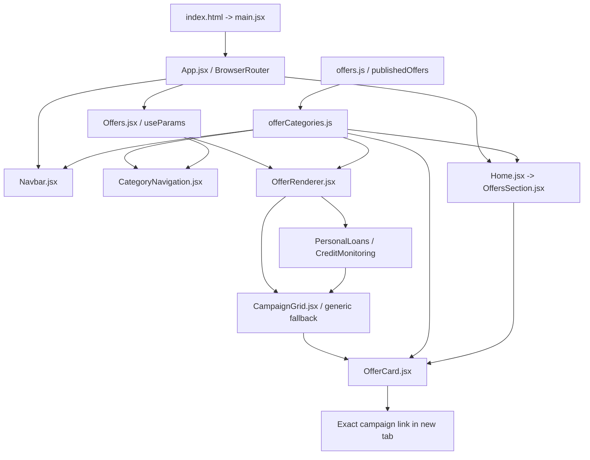

# SuperPremiumOffers: Category Developer Guide

Simple Hinglish guide, final implemented code ke liye.

Project root: `E:\VISHAL LOVANSHI\All InOne`.
Neeche har `src/...` path isi root ke andar actual file hai. Ordinary category/campaign changes ke liye sirf **2 code files** edit karni hain: `src/data/offerCategories.js` aur `src/data/offers.js`. Self logo currently provided nahi; approved logo `src/images/self-credit-builder.png` mein add karna alag asset step hai. Naya route ya category component normally banana nahi padta.

## Section A - Actual project structure

Yeh inspected project tree hai. Installed dependencies (`node_modules/`) aur generated build output (`dist/`) ko tree se exclude kiya hai.

```text
All InOne/
|-- public/
|   |-- .htaccess
|   |-- 300e90219bef1759941f487b61d21f90.jpg
|   |-- c4904e0eec5ac7bff4852be3ea1d3587.jpg
|   |-- df0ba9cb94b7066138925676d5251375.jpg
|   |-- e054ec1a6e8e1f76d4371c7ce59b6552.jpg
|   `-- vite.svg
|-- src/
|   |-- assets/
|   |-- components/
|   |   |-- About.jsx
|   |   |-- CallPopup.jsx
|   |   |-- CampaignGrid.jsx
|   |   |-- CategoryNavigation.jsx
|   |   |-- CTA.jsx
|   |   |-- Footer.jsx
|   |   |-- Hero.jsx
|   |   |-- HowItWorks.jsx
|   |   |-- LegalPageLayout.jsx
|   |   |-- Navbar.jsx
|   |   |-- OfferCard.jsx
|   |   |-- OfferRenderer.jsx
|   |   |-- OffersSection.jsx
|   |   |-- ScrollToTop.jsx
|   |   `-- WhyChooseUs.jsx
|   |-- data/
|   |   |-- offerCategories.js
|   |   `-- offers.js
|   |-- images/
|   |   |-- 835190a5-0652-4a5f-8289-40ddce67c6c0.png
|   |   |-- Badcreadteloan.png
|   |   |-- badcredite.png
|   |   |-- bg.png
|   |   |-- Emergency.png
|   |   |-- Emergencyloan.png
|   |   |-- favicons.png
|   |   |-- heroBGIM.png
|   |   |-- herobgimag.png
|   |   |-- heroBGimage2.png
|   |   |-- imagesBGHRO.png
|   |   |-- insatantCash.png
|   |   |-- landing.png
|   |   |-- logo.png
|   |   |-- MO.png
|   |   |-- mony.png
|   |   |-- Personal loan.png
|   |   |-- Red.png
|   |   |-- redcard.png
|   |   |-- trans.jpeg
|   |   |-- unnamed.png
|   |   `-- weblogo.png
|   |-- pages/
|   |   |-- offersPages/
|   |   |   |-- CreditMonitoring.jsx
|   |   |   `-- PersonalLoans.jsx
|   |   |-- Contact.jsx
|   |   |-- Home.jsx
|   |   |-- Offers.jsx
|   |   |-- PrivacyPolicy.jsx
|   |   `-- TermsConditions.jsx
|   |-- App.css
|   |-- App.jsx
|   |-- index.css
|   `-- main.jsx
|-- .gitignore
|-- CATEGORY_DEVELOPER_GUIDE.md
|-- eslint.config.js
|-- IMPLEMENTATION_NOTES.md
|-- index.html
|-- package-lock.json
|-- package.json
|-- README.md
`-- vite.config.js
```

`src/components/` reusable UI blocks hain. `src/pages/` route-level screens hain. `public/.htaccess` Apache fallback hai, Vite build usse dist root mein copy karta hai. `src/components/LegalPageLayout.jsx` shared legal-page design, responsive table of contents, draft banner aur section icons render karta hai. `src/pages/PrivacyPolicy.jsx` aur `TermsConditions.jsx` is layout mein alag content dete hain. `src/pages/offersPages/` preserved category components hain. `src/data/` content/configuration ka single source hai. `src/images/` approved campaign creatives aur branding assets rakhta hai. `public/` mein existing reference/template JPGs aur `vite.svg` hain; unhe campaign creatives ki jagah use nahi kiya gaya.

Actual campaign images: `unnamed.png` (Lending For Bad Credit), `redcard.png` (RedArrowLoans), `MO.png` (MoneyMutual), `trans.jpeg` (supplied TransUnion logo). Self creative missing hai; Self card honest creative-pending placeholder dikhata hai. Existing campaign URLs/descriptions preserve hain.

Missing client assets:
- `src/images/transunion-credit-essentials.png`: actual approved TransUnion creative. Abhi supplied local `src/images/trans.jpeg` logo complete natural aspect ratio mein dikhta hai. Full approved campaign creative add karne par logo fallback replace ho jayega. Dono unavailable hon to honest creative-pending message hai. Logo full campaign advertisement nahi hai.
- `src/images/premium-offers-hero.jpg`: approved multi-category hero image. Abhi Hero category illustrations dikhata hai.

Dono optional image references Vite glob se load hote hain. Asset add karne ke baad production ke liye dobara build karna hai. Is request ke attachment folder mein text file thi; two reference screenshots attached nahi mile. Layout written specifications se implement hua.

## Section B - File responsibilities: kab kya edit karein

### `index.html`
Browser ka entry HTML hai. `#root` container aur `/src/main.jsx` script load karta hai. SEO title, description aur favicon yahan hain. Koi React props nahi leta. SEO change karna ho to edit karo; category add karne ke liye nahi.

### `src/main.jsx`
React, `StrictMode`, `createRoot`, `App` aur `index.css` import karta hai. React app ko HTML ke `#root` mein mount karta hai. Development StrictMode extra checks karta hai. User data ya category props nahi leta. App startup/global CSS badalna ho tab edit karo.

### `src/App.jsx`
React Router ka `BrowserRouter`, `Routes`, `Route`, global Navbar/Footer/ScrollToTop aur route pages import karta hai. Main application shell render karta hai: Navbar -> selected page -> Footer. Routes `/`, `/offers`, `/offers/:category`, `/contact`, `/privacy`, `/terms` existing hain. App `main.jsx` se use hota hai. New standalone route chahiye tab edit karo. New category ke liye existing dynamic route enough hai, isliye App mein duplicate route mat add karo.

### `src/components/Navbar.jsx`
React hooks, Router `useLocation`/`useNavigate`, Lucide icons, branding logo aur `availableOfferCategories` import karta hai. Global App use karta hai; external props nahi leta. Fixed navbar, desktop dropdown aur mobile navigation render karta hai. `goToCategory(slug)` menu close karke `navigate('/offers/' + slug)` chalata hai. Selected highlight `location.pathname` se aata hai. `handleCategoryKeys` ArrowUp/Down/Home/End support karta hai. Escape, outside click aur navigation par menu close hota hai. List ki max-height aur scoped scrollbar hain; navbar itself scroll nahi hota. Navigation appearance/interaction change karna ho tab edit karo. Category list manually yahan mat add karo.

### `src/data/offers.js`
Approved images import karta hai aur TransUnion optional full creative/local logo ke liye `import.meta.glob` use karta hai. `offers` campaign objects ki single array hai. Har item mein unique `id`, `status`, `categoryId`, `title`, `description`, `image`, `link` aur optional fields hote hain. `publishedOffers` sirf `status: 'published'` entries return karta hai. React component nahi hai: kuch render nahi karta aur props nahi leta. `offerCategories.js` is data ko consume karta hai. Campaign add/update/disable karna ho to yahi file edit karo.

### `src/data/offerCategories.js`
Lucide icons aur `publishedOffers` import karta hai. Category ki `id`, `label`, `slug`, `icon`, `description`, `status` yahan define hoti hain. Array pehle `priority` se order hoti hai, phir label A-Z se. `Building Your Credit Score` ke liye `priority: 0` hai, isliye first rehta hai. Baaqi categories priority omit karke alphabetical rehti hain. Is file ka output Navbar, CategoryNavigation, Offers, OfferRenderer, footer, category wrappers, OfferCard, OffersSection aur Hero use karte hain. Koi JSX render nahi karta.

Exports:
- `offerCategories`: sab registered categories, including unavailable ones.
- `availableOfferCategories`: category enabled (`status: 'available'`) ho **aur** kam se kam ek published campaign ho.
- `availableOffers`: published campaigns whose category is currently available.
- `getCategoryOffers(categoryId)`: us category ke available campaigns.
- `getOfferCategory(slug)`: URL slug ka registered category object; unknown slug par `undefined`.

Category add/rename/disable karna ho to edit karo. Normally `id` aur `slug` same stable value rakhna easiest hai, lekin `categoryId` actual `id` se match hona chahiye; URL `slug` se banta hai. `Building Your Credit Score` first pinned category hai; all other items A-Z. Uski priority same rakhni; baaki new categories ko `priority` mat do.

### `src/pages/Offers.jsx`
Router `useParams`/`Link`, category lookup, CategoryNavigation aur OfferRenderer import karta hai. App ke `/offers` aur `/offers/:category` routes use karte hain. Props nahi leta: URL se `slug` padhta hai. Sidebar/mobile selector, selected heading, description aur renderer render karta hai. `selected={slug}` OfferRenderer ko pass hota hai. `/offers` par slug absent hai: All Offers render hota hai. Unknown slug par "Category not found" aur return link; disabled known category par honest empty state. Page layout change karna ho tab edit karo, category names yahan hardcode mat karo.

### `src/components/CategoryNavigation.jsx`
React, Router `NavLink`/`useLocation`, Lucide icons aur shared category data import karta hai. Offers page use karta hai; props nahi leta. Internal `CategoryLinks({ onSelect })` All Offers + available A-Z categories ke links render karta hai. `NavLink` current URL match karke `aria-current='page'` aur blue gradient active style deta hai. Desktop sidebar 272px wide aur navbar ke neeche 106px par sticky hai. Sidebar header fixed rehta hai; list limited height par scroll hoti hai. Below 1024px native `<details>/<summary>` expandable selector dikhata hai; Enter/Space/tap supported. Selection panel close karti hai. Sidebar UX/styling edit karna ho tab yeh file change karo.

### `src/components/OfferRenderer.jsx`
Shared campaign/category helpers, CampaignGrid, PersonalLoans aur CreditMonitoring import karta hai. Offers page use karta hai aur `selected` URL slug prop deta hai. `selected` absent ho to `availableOffers`; specific slug ho to `getCategoryOffers(category.id)`. Empty array par honest empty state. Existing categories ke preserved components `customRenderers` map se use hote hain. Map mein category na ho to CampaignGrid automatically render hota hai. Isliye new ordinary category ke liye switch case/import add nahi karna. Sirf special category layout chahiye tab optional custom renderer register karo.

### `src/components/CampaignGrid.jsx`
React aur OfferCard import karta hai. OfferRenderer aur dono category wrappers use karte hain. `offers` prop already filtered campaign array hai. Har item ko unique `offer.id` key ke saath `<OfferCard offer={offer} index={index} />` deta hai. Grid ek column below 768px, exactly two columns from 768px onward; three-column rule nahi hai. Desktop sidebar 1024px se aata hai. `items-start` aur natural card heights varying copy ko unnecessary stretching se bachate hain. Card-list layout change karna ho tab edit karo; campaign copy yahan nahi.

### `src/components/OfferCard.jsx`
React, Lucide icons aur `offerCategories` import karta hai. CampaignGrid aur homepage OffersSection use karte hain. Receives `offer` object aur optional `index` (default 0). Category label `categoryId` se config mein lookup hota hai; har campaign mein duplicate category name likhne ki need nahi. Complete image, category badge, optional featured badge/subtype, title, optional amount/highlights/disclaimer aur CTA render karta hai. Images `h-auto w-full object-contain` hain: no fixed image box, zoom cropping, decorative overlay or text/logo obstruction. Card itself natural content height leta hai. Existing border radius, gradients, shadow, card hover aur CTA shine animation preserve hain.

`amount` absent ho to amount block render nahi hota. `disclaimer` absent ho to loan disclosure auto-add nahi hota. Personal Loans ke liye optional `offer.phone` telephone action retained hai; TransUnion mein phone nahi. Blue campaign CTA always "Learn More" hai; legacy `buttonText` field label override nahi karta. External anchor exact `offer.link`, `target='_blank'`, `rel='noopener noreferrer'` use karta hai. Card styling change karna ho tab edit karo; actual campaign content data file mein edit karo.

### `src/pages/offersPages/PersonalLoans.jsx` and `CreditMonitoring.jsx`
React, CampaignGrid aur `getCategoryOffers` import karte hain. OfferRenderer use karta hai. External props nahi lete. Respectively `personal-loans` aur `credit-monitoring` id ke filtered campaigns CampaignGrid ko pass karte hain. Separate campaign arrays nahi hain. Existing files preserve hain aur future category-specific extra content ka extension point hain. Normal new category ke liye aisi wrapper file compulsory nahi.

### `src/pages/Home.jsx` and `src/components/OffersSection.jsx`
Home App ke `/` route par aata hai. It imports Hero, OffersSection, WhyChooseUs, HowItWorks, About, CTA and renders them in order; no category props. OffersSection React/Lucide, OfferCard aur `availableOffers` import karta hai, so disabled/draft campaigns homepage par bhi hide hote hain. It renders featured heading, shared cards and information panels. Homepage campaign grid bhi maximum two columns hai. Homepage section layout edit karna ho to OffersSection edit karo; campaign data dono pages par automatically update hota hai.

### Other relevant files
- `Hero.jsx`: Home uses it. React/Lucide, Router Link, `offerCategories` and optional hero asset. No props; premium heading, CTA and category illustrations render karta hai. Illustrations category range dikhate hain, active campaign availability claim nahi.
- `ScrollToTop.jsx`: App uses it; `useEffect` + `useLocation`. No props/no visible UI. Pathname change par scroll top; category history navigation intact.
- `Footer.jsx`: App uses it; React/Router/Lucide/logo and `availableOfferCategories`. No props. Global footer links, legal disclosures, homepage-section navigation and shared live offer-category links.
- `About.jsx`, `HowItWorks.jsx`, `WhyChooseUs.jsx`, `CTA.jsx`: Home uses them; React + Lucide, local copy/data, no external category props. General information and smooth-scroll CTAs render karte hain; campaigns define nahi karte.
- `Contact.jsx`: App route; React `useState`/Lucide. No props. Form local state and submit handler. Existing handler logs data and displays submitted state; backend/API integration currently not implemented. This UI update doesn't change that behavior.
- `PrivacyPolicy.jsx`, `TermsConditions.jsx`: App route pages; React, Router Link and Lucide; no campaign props. Legal sections render karte hain.
- `CallPopup.jsx`: React hooks/Lucide/localStorage; currently App import/render commented out. No props. Optional telephone popup, no new number supplied. Existing hooks warning remains here.
- `src/index.css`: imported by main; Tailwind import, base typography, animations, reduced-motion and `.category-scroll` scoped scrollbar. No scrollbar plugin needed.
- `src/App.css`: exists, currently empty and not imported.
- `vite.config.js`: imports `defineConfig` and Tailwind Vite plugin; Vite build/dev configuration. React plugin package installed hai but config mein enabled nahi; JSX files ka explicit React import preserve karo.
- `package.json`/`package-lock.json`: dependencies and scripts. Category addition ke liye dependency install normally required nahi.
- `eslint.config.js`: JavaScript/React hooks lint rules. Build code ki syntax/bundling check karta hai; lint additional code issues detect karta hai.
- `IMPLEMENTATION_NOTES.md`: implementation history/status. New developer instructions ka main reference yeh guide hai.

## Section C - Component connections and actual click flow



1. Customer website open karta hai: index.html -> main.jsx `createRoot(...).render(...)` -> App. BrowserRouter current URL se page choose karta hai; Navbar/Footer global hain.
2. Navbar mein Offer Categories: desktop `dropdownOpen` state hover/click se open; mobile `mobileCategoriesOpen` tap se expand. List `availableOfferCategories` se A-Z aati hai.
3. Credit Monitoring select: Navbar `goToCategory('credit-monitoring')` menus close karke React Router `navigate('/offers/credit-monitoring')` call karta hai.
4. App `/offers/:category` route match karta hai; Offers render hota hai. ScrollToTop pathname change detect karta hai.
5. Offers `useParams()` se `category: 'credit-monitoring'` padhta hai; `getOfferCategory` heading/description deta hai. Sidebar NavLink current URL se highlight hota hai.
6. OfferRenderer `selected='credit-monitoring'` receives karta hai, category ke `id` se `getCategoryOffers` data leta hai. Preserved CreditMonitoring component -> CampaignGrid -> OfferCard. Single TransUnion campaign aati hai, amount/phone nahi.
7. Customer Learn More click: OfferCard ka `<a>` exact `offer.link` use karta hai. Koi guessed URL ya intermediate tracking replacement nahi.
8. Browser **new tab** mein `https://www.transunion.com/credit-scores-reports/credit-essentials` open karta hai. Original tab website par rehta hai; same-tab React redirect nahi hota.

URL selected category ka single source hai. Refresh, back/forward aur Navbar/sidebar selection alag `selectedCategory` state sync kiye bina work karte hain.

## Section D - Add a new category: Auto Insurance in 12 steps

Neeche examples **draft maintenance templates** hain, new campaign claims/URLs nahi. Client-approved details milne tak publish mat karo.

1. `src/data/offerCategories.js` open karo. Lucide import mein `Car` add karo.
2. `offerCategories` array mein entry add karo:

```js
{
  id: "auto-insurance",
  label: "Auto Insurance",
  slug: "auto-insurance",
  icon: Car,
  description: "Review auto insurance offer details and provider terms.",
  status: "unavailable", // Enable after approved campaign is ready.
  // `priority` omit karo to alphabetical; pinned category ka priority 0 hota hai.
},
```

3. Standard card layout ke liye new AutoInsurance.jsx page **required nahi**. Existing generic renderer enough hai.
4. OfferRenderer edit **required nahi**. It automatically uses CampaignGrid for categories without custom renderer.
5. Navbar manually edit **required nahi**. `availableOfferCategories` se category auto-appears only after enabled and published content exists.
6. Sidebar/mobile selector manually edit **required nahi**. Same config consumed by CategoryNavigation. Sorting automatic hai.
7. Campaign `src/data/offers.js` ke `offers` array mein add karo. Unique campaign `id` aur matching `categoryId: 'auto-insurance'` must hain.
8. Actual approved creative `src/images/auto-insurance-campaign.png` mein save karo, **file exist hone ke baad** `offers.js` top par import karo:

```js
import approvedAutoImage from "../images/auto-insurance-campaign.png";
```

9. Campaign title/marketing description exact approved text se fill karo. Example draft object:

```js
{
  id: "auto-insurance-campaign-1",
  status: "draft",
  categoryId: "auto-insurance",
  title: "CLIENT_APPROVED_TITLE",
  image: approvedAutoImage,
  imageAlt: "CLIENT_APPROVED_CREATIVE_DESCRIPTION",
  description: "CLIENT_APPROVED_MARKETING_TEXT",
  link: "", // Paste exact approved URL before publishing.
},
```

10. `link` mein exact client-approved external campaign URL/tracking parameters paste karo. Example placeholder text ko real offer ki tarah publish mat karo. Optional `disclaimer`, `badge`, `highlights` sirf accurate supplied content ho to add karo; `amount` insurance campaign mein automatically needed nahi.
11. Same category mein second campaign chahiye to another object add karo: new unique id, same `categoryId`, separate approved image/copy/link. Duplicate same campaign object mat add karo. Approved content ready hone par campaign `status: 'published'` aur category `status: 'available'` set karo.
12. `/offers/auto-insurance` directly open + refresh karo, Navbar/sidebar selection, All Offers, Learn More external URL, image ratios, back/forward aur mobile check karo. `npm run build` and `npm run lint` run karo.

Custom category UI exceptional case: `src/pages/offersPages/AutoInsurance.jsx` create karke approved extra content + CampaignGrid render karo; OfferRenderer mein import aur `customRenderers['auto-insurance']` mapping add karo. Standard categories mein yeh extra files/edits unnecessary hain. `App.jsx` phir bhi edit nahi karna.

## Section E - Add another Credit Monitoring campaign

1. Approved creative `src/images/` mein add karo; approved file ka import `src/data/offers.js` mein add karo.
2. `offers` array mein new object add karo with unique id and `categoryId: 'credit-monitoring'`.
3. Exact approved title, copy, link aur optional disclaimer/highlights fill karo. Draft example:

```js
{
  id: "credit-monitoring-campaign-2",
  categoryId: "credit-monitoring",
  status: "draft",
  title: "CLIENT_APPROVED_TITLE",
  description: "CLIENT_APPROVED_MARKETING_TEXT",
  image: approvedMonitoringImage, // Actual import first.
  link: "", // Exact approved landing/tracking URL needed.
},
```

4. All fields approved/verified hone par `status` ko `published` karo. Existing category already available hai, so `offerCategories.js` edit nahi needed.
5. CreditMonitoring component, Navbar, sidebar, App aur renderer edit nahi needed. New card category page, All Offers aur homepage par automatically aayegi.
6. Confirm both Credit Monitoring campaigns distinct hain, correct new-tab links use karte hain, 2-column desktop/1-column mobile layout maintained hai.

## Section F - Update an existing campaign

`src/data/offers.js` mein campaign `id` find karo. `id` stable rakho so React key consistent rahe.

- Title: `title` edit karo.
- Marketing copy: `description` edit karo, client-approved exact text use karo.
- Badge: `badge: 'Featured'` ya approved text; hide ke liye omit/null.
- Creative: approved new asset import karke `image` property update karo; optional accurate `imageAlt` add karo. Image width/height CSS edit nahi needed.
- External link: `link` mein exact approved complete URL incl. affiliate/tracking parameters preserve karo.
- Category: `categoryId` change only if campaign genuinely belongs there; category object ke `id` se exact match.
- Amount/highlights/disclaimer: category-relevant accurate data ho tab provide karo, otherwise omit.
- Phone: existing Personal Loans campaign mein approved `phone` add kar sakte ho; no fake business number. Non-loan campaign ko telephone CTA auto-add nahi hota.
- CTA: always Learn More, fixed in OfferCard. Existing `buttonText` value secondary metadata hai; component label override nahi karta.

TransUnion original exact copy/URL `offers.js` mein already hain. Missing TransUnion image path add karne par optional glob next build mein automatically load karega; other campaigns' missing static imports build fail karenge.

## Section G - Safely remove or disable

Category hide karni ho: `offerCategories.js` mein `status: 'unavailable'` karo. Data aur stable slug retain karo. Navbar/sidebar/All Offers/homepage se hide hogi. Old category URL remains recognized and honest empty state dikhega; loans par silent redirect nahi hoga.

Single campaign hide karna ho: `offers.js` mein `status: 'disabled'` ya `draft` karo. Baaki published campaigns unaffected. Last published campaign disabled ho to category automatically navigation se hide hogi, even if category status still available hai.

Category object delete karna old URL ko unknown bana dega, isliye normal disable flow mein delete mat karo. Slug change old links break karega; stable slug preserve karo. Custom wrappers delete karna ho to customRenderers/imports bhi update karne padenge; normal content changes ke liye wrappers touch mat karo.

## Section H - Common errors and fixes

- **React is not defined:** current Vite config classic JSX transform use karta hai. JSX file mein `import React from 'react'` preserve karo.
- **Failed to resolve import:** relative path wrong, typo, file absent ya filename case mismatch. `offers.js` se images `../images/...`; offersPages wrapper se components `../../components/...` hain. Production Linux filename case-sensitive ho sakta hai.
- **Image broken/missing:** approved file path/extension verify karo. Static import file absent ho to build error. TransUnion full creative absent ho to local logo fallback; dono absent ho to deliberate placeholder. Placeholder ko approved ad mat samjho.
- **Category doesn't appear:** category status available? At least one campaign status published? `categoryId` exact category `id`? All three conditions check karo.
- **Category not found:** URL slug registered `slug` se match nahi. Spaces/case/typo avoid karo; lowercase hyphens use karo.
- **Duplicate cards/key warning:** unique campaign ids required; same campaign array multiple places duplicate mat rakho. Shared data use karo.
- **All categories unexpectedly hidden:** campaign `status` required hai; typo `publish` instead of `published` means excluded. Category status `available` vs campaign `published` alag fields hain.
- **Blank amount block:** component optional amount guard use karta hai; missing amount okay. Fake amount fill mat karo.
- **More than two desktop columns:** CampaignGrid has only `md:grid-cols-2`; `lg:grid-cols-3` rule add mat karo. Homepage OffersSection also maximum two columns.
- **Scrollbar invisible with two categories:** expected, content fit hota hai to scroll needed nahi. Many categories honge to bounded lists scroll karengi; only category list scroll hoti hai.
- **Direct route works locally but production refresh 404:** host must fall back to `index.html` for React Router URLs. Existing hosting SPA rule verify karo; new duplicate React routes don't fix server 404.
- **Existing lint warning:** disabled CallPopup.jsx effect dependency warning unrelated to category changes; no lint errors.

## Section I - Testing checklist and completed checks

After real content change:

```powershell
npm run dev -- --host 127.0.0.1
npm run build
npm run lint
```

- Open `/offers`: all published campaigns from available categories, no duplicate/draft campaigns.
- Open `/offers/personal-loans`: three preserved campaigns; approved images/amounts/copy/URLs intact.
- Open `/offers/credit-monitoring`: TransUnion correct copy and exact landing URL; no amount/loan disclosure/phone action.
- Test new `/offers/auto-insurance` only after approved content is added. Refresh, back/forward, Navbar/sidebar both directions.
- Unknown slug: meaningful not-found; known disabled category: empty state.
- Desktop 1024px and above: 272px sticky sidebar, remaining width for exactly two equal card columns. Large 1920px screen still two columns.
- Below 768px: one card column. 768-1023px: two columns with expandable category selector instead of narrow sidebar.
- Full campaign image remains visible with natural aspect ratio; no stretching, text cropping or overlay obstruction.
- Nav desktop dropdown: hover/click, Tab, ArrowUp/Down, Home/End, Escape/outside click, selected highlight, wheel scrolling when overflowing.
- Mobile: tap/Enter summary, select link, panel closes, highlight/heading update, touch list scroll when content overflows.
- Check each Learn More href exact; target `_blank`, rel `noopener noreferrer`.
- Browser console: no runtime/missing-import/key errors. Horizontal overflow and broken image check.

Completed automated checks and final UI/build results are recorded in IMPLEMENTATION_NOTES.md. Build doesn't replace runtime testing.


## New client update: Building Your Credit Score and legal drafts

`Building Your Credit Score` (`building-your-credit-score`) `TrendingUp` icon ke saath first pinned category hai. `offerCategories.js` priority sort first applies karta hai, uske baad ordinary categories alphabetical hain. Navbar, Offers sidebar/mobile panel aur Footer same populated category config use karte hain.

`offers.js` mein Self Credit Builder exact marketing copy, `categoryId: 'building-your-credit-score'` aur supplied tracking URL ke saath published campaign hai. Existing generic OfferRenderer/CampaignGrid already usse render karte hain; separate page/component ki zaroorat nahi. Client ka Self logo attachment/project mein nahi mila. `src/images/self-credit-builder.png` add karoge to optional Vite glob use karega; tab tak campaign card placeholder dikhata hai. `/offers` par Self campaign remaining campaigns ke saath dikhta hai. Credit Monitoring separate hai.

Privacy aur Terms pages `src/components/LegalPageLayout.jsx` shared accessible/responsive shell use karte hain. Draft banner and section-level owner-review callouts visible hain. Verified nahi business details, data vendors, contact method, jurisdiction ya commercial relationships invent nahi kiye gaye. Contact form code values browser console mein log karta hai, aur koi API integration nahi hai; policy draft prominently identifies this. Owner must remove/resolve this behavior and get qualified legal review before publishing final statements.

`public/.htaccess` Apache `mod_rewrite` fallback ko configure karta hai, static files ko preserve karke `/privacy`, `/terms`, aur dynamic `/offers/:category` ko `index.html` par bhejta hai. Vite build se `dist/.htaccess` copy hona validate karo. Yeh file root-domain Apache/Hostinger deployment assume karti hai; subdirectory hosting ke liye `RewriteBase` and path rules host ke mutabiq adjust karo. Actual production host, Apache module and DNS/deployment settings is workspace se verify nahi kiye gaye.
